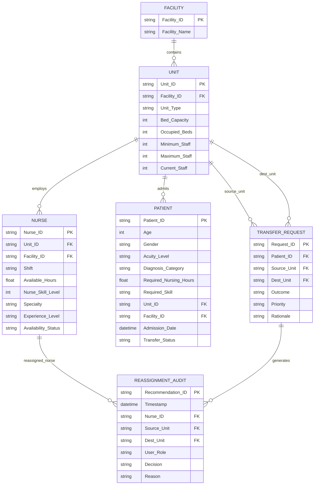

# 🏥 Shift Workload-Balancing Simulator for Hospital Patient Transfers

[](https://www.python.org/)
[](https://streamlit.io/)
[-brightgreen.svg)]()
[]()
[]()

A quantitative, clinical decision-support software simulator that models patient acuity-weighted nursing workload, computes unit staffing deficits and donor surpluses, evaluates patient transfers across 7 deterministic outcome states, and recommends **safe, skill-matched nurse reassignments** without breaching donor unit minimum safe staffing bounds or physical bed capacities.

---

## 1. Project Overview & Clinical Problem
Hospital networks transfer patients continuously across acute, emergency, and general wards. However, shift managers lack real-time visibility into cross-unit nursing workload imbalances. Manual assessments often cause nurse burnout, severe workload variance, or dangerous violations of minimum safe staffing bounds. 

This project delivers an end-to-end, multi-page web simulator and decision-support engine that stabilizes workload intensity while strictly enforcing **8 hard clinical safety rules** and providing complete decision traceability through an automated audit log.

---

## 2. Core Objectives
1. **Dynamic Acuity-Weighted Workload Modeling**: Quantify nursing workload per patient and unit using clinical acuity weighting.
2. **Staffing Deficit & Donor Surplus Identification**: Compute unit staffing gaps and identify units with safe surplus staff above regulatory minimums.
3. **Deterministic Patient Transfer Outcomes**: Evaluate inbound and inter-facility transfer requests across 7 explicit outcome states.
4. **Safe Nurse Reassignment Engine**: Enforce `validate_safe_reassignment()` across 8 core safety rules to eliminate unsafe staff transfers.
5. **Operating Scenario Stress Testing**: Simulate 8 complex hospital stress conditions (Acuity Spikes, Staff Shortages, Transfer Surges, Specialist Gaps).
6. **Clinical Governance & Escalation Tracking**: Provide timestamped audit logging of manager approvals/overrides and automated escalation of overdue items.

---

## 3. System Architecture
```
[Synthetic Hospital Dataset (~5,200 Patients)]
                    │
                    ▼
      [Data Cleaning Pipeline (src/data_cleaning.py)]
                    │
                    ▼
      [Clean Data Repository (data/clean/)]
                    │
        ┌───────────┴───────────┐
        ▼                       ▼
 [Workload & Staffing]   [Skill Matching Engine]
 (src/workload.py &      (src/skill_matching.py)
  src/staffing.py)              │
        │                       ▼
        │            [Transfer Decision Logic]
        │            (src/transfer_logic.py)
        └───────────┬───────────┘
                    ▼
        [Scenario Simulator Engine]
            (src/simulator.py)
                    │
        ┌───────────┼───────────┐
        ▼           ▼           ▼
 [7-Page App] [Pytest Suite] [Audit & Escalation]
 (dashboard/)   (tests/)     (src/escalation.py)
```

---

## 4. Database Schema & Relational Architecture

The simulator architecture uses a relational data model representing hospital facilities, units, nurse rosters, patient census records, transfer requests, and audit logs.

### Entity-Relationship Diagram (ERD)



### Relational Schema Specifications

#### Table: `units` (`data/clean/units.csv`)
| Column Name | Data Type | Constraints | Nullable | Description |
|---|---|---|---|---|
| `Unit_ID` | VARCHAR(10) | PRIMARY KEY | No | Unique hospital unit identifier (e.g. `U001`) |
| `Facility_ID` | VARCHAR(10) | FOREIGN KEY $\rightarrow$ `facilities.Facility_ID` | No | Parent hospital facility identifier |
| `Facility_Name` | VARCHAR(100) | | No | Hospital facility full name |
| `Unit_Type` | VARCHAR(50) | CHECK in ('ICU', 'Emergency', 'Med-Surg', 'Pediatrics', 'Oncology') | No | Canonical specialty category of the unit |
| `Bed_Capacity` | INTEGER | CHECK (Bed_Capacity > 0) | No | Total licensed bed count in the unit |
| `Occupied_Beds` | INTEGER | CHECK (Occupied_Beds >= 0) | No | Active patient census currently occupying beds |
| `Minimum_Staff` | INTEGER | CHECK (Minimum_Staff > 0) | No | Minimum safe nurse staffing threshold |
| `Maximum_Staff` | INTEGER | CHECK (Maximum_Staff >= Minimum_Staff) | No | Maximum physical nurse capacity for shift |
| `Current_Staff` | INTEGER | CHECK (Current_Staff >= 0) | No | Assigned baseline nurse headcount |

#### Table: `nurses` (`data/clean/nurses.csv`)
| Column Name | Data Type | Constraints | Nullable | Description |
|---|---|---|---|---|
| `Nurse_ID` | VARCHAR(10) | PRIMARY KEY | No | Unique nurse identification number (e.g. `N0001`) |
| `Unit_ID` | VARCHAR(10) | FOREIGN KEY $\rightarrow$ `units.Unit_ID` | No | Primary unit assignment |
| `Facility_ID` | VARCHAR(10) | FOREIGN KEY $\rightarrow$ `facilities.Facility_ID` | No | Parent facility assignment |
| `Shift` | VARCHAR(20) | CHECK in ('Day', 'Evening', 'Night') | No | Assigned operational shift window |
| `Available_Hours` | FLOAT | CHECK (Available_Hours >= 0.0) | No | Total available duty hours for shift |
| `Nurse_Skill_Level`| INTEGER | CHECK (Nurse_Skill_Level BETWEEN 1 AND 4) | No | Competency level: 1 (Basic) to 4 (Expert) |
| `Specialty` | VARCHAR(50) | CHECK in ('ICU', 'Emergency', 'Med-Surg', 'Pediatrics', 'Oncology', 'General') | No | Certified clinical nursing specialty |
| `Experience_Level` | VARCHAR(20) | CHECK in ('Junior', 'Mid', 'Senior', 'Specialist') | No | Experience classification bracket |
| `Availability_Status`| VARCHAR(30) | CHECK in ('Available', 'On Shift', 'Off Duty', 'Reassigned', 'Specialist Shortage') | No | Real-time duty availability state |

#### Table: `patients` (`data/clean/patients.csv`)
| Column Name | Data Type | Constraints | Nullable | Description |
|---|---|---|---|---|
| `Patient_ID` | VARCHAR(10) | PRIMARY KEY | No | Unique patient record number (e.g. `P00001`) |
| `Age` | INTEGER | CHECK (Age > 0 AND Age <= 120) | No | Sanitized patient age in years |
| `Gender` | VARCHAR(20) | CHECK in ('Male', 'Female', 'Non-Binary') | No | Patient biological/identified gender |
| `Acuity_Level` | VARCHAR(20) | CHECK in ('Low', 'Medium', 'High', 'Critical') | No | Clinical acuity classification tier |
| `Diagnosis_Category`| VARCHAR(100) | | No | Primary admission diagnosis description |
| `Required_Nursing_Hours`| FLOAT | CHECK (Required_Nursing_Hours BETWEEN 1.0 AND 16.0) | No | Prescribed care hours required per 12h shift |
| `Required_Skill` | VARCHAR(50) | CHECK in ('ICU', 'Emergency', 'Med-Surg', 'Pediatrics', 'Oncology') | No | Specialty skill mix mandated by patient condition |
| `Unit_ID` | VARCHAR(10) | FOREIGN KEY $\rightarrow$ `units.Unit_ID` | No | Assigned hospital unit |
| `Facility_ID` | VARCHAR(10) | FOREIGN KEY $\rightarrow$ `facilities.Facility_ID` | No | Assigned facility identifier |
| `Admission_Date` | DATETIME | | No | Timestamp of patient admission |
| `Transfer_Status` | VARCHAR(30) | CHECK in ('Admitted', 'Pending Transfer', 'Transfer Approved', 'Discharged') | No | Current operational transfer status |

#### Table: `audit_log` (`data/audit_log.csv`)
| Column Name | Data Type | Constraints | Nullable | Description |
|---|---|---|---|---|
| `Timestamp` | DATETIME | DEFAULT CURRENT_TIMESTAMP | No | Exact ISO timestamp of human clinical decision |
| `Recommendation_ID`| VARCHAR(20) | | No | Associated recommendation identifier |
| `Nurse_ID` | VARCHAR(10) | FOREIGN KEY $\rightarrow$ `nurses.Nurse_ID` | No | Reassigned nurse identifier |
| `Source_Unit` | VARCHAR(10) | FOREIGN KEY $\rightarrow$ `units.Unit_ID` | No | Donor unit releasing nurse |
| `Dest_Unit` | VARCHAR(10) | FOREIGN KEY $\rightarrow$ `units.Unit_ID` | No | Receiving unit acquiring nurse |
| `User_Role` | VARCHAR(50) | | No | Role of decision maker (e.g. `Shift Manager`) |
| `Decision` | VARCHAR(20) | CHECK in ('Approved', 'Rejected', 'Overridden') | No | Action taken by clinical manager |
| `Reason` | TEXT | | Yes | Clinical or operational justification note |

---

## 5. API Endpoints & Function Specifications

The simulator provides modular, type-annotated public function interfaces adhering to strict software contracts:

### Module: `src/workload.py`

#### `calculate_patient_workload(df_patients, acuity_weights=None, active_only=True) -> pd.DataFrame`
* **Description**: Multiplies base care hours by clinical acuity weights for admitted patients.
* **Parameters**:
  - `df_patients` (*pd.DataFrame*): Patient records table.
  - `acuity_weights` (*dict*, optional): Mapping of acuity strings to float weights (defaults to `{'Low': 1.0, 'Medium': 1.25, 'High': 1.5, 'Critical': 2.0}`).
  - `active_only` (*bool*, default=`True`): Filters for active patients (`Admitted`, `Pending Transfer`).
* **Returns**: Augmented DataFrame with `Acuity_Weight` (float) and `Patient_Workload` (float).
* **Error Boundary**: Empty DataFrame returns empty DataFrame with expected columns without raising exceptions. Missing acuity levels default to `1.0`.

#### `calculate_unit_workload(df_patients, acuity_weights=None) -> pd.DataFrame`
* **Description**: Aggregates patient-level workload metrics per unit and normalizes across a 12h operational shift horizon.
* **Returns**: DataFrame with columns `['Facility_ID', 'Unit_ID', 'Total_Patients', 'Cumulative_Workload', 'Total_Required_Hours', 'Avg_Patient_Workload', 'Total_Workload']`.

#### `calculate_workload_imbalance_metrics(staffing_df) -> dict`
* **Description**: Computes statistical workload spread metrics across all units.
* **Returns**:
  ```python
  {
      "Max_Workload_Per_Nurse": float,
      "Min_Workload_Per_Nurse": float,
      "Workload_Imbalance_Max_Min_Gap": float,
      "Workload_Imbalance_Std": float,
      "Workload_Mean": float,
      "Coefficient_of_Variation_Pct": float
  }
  ```
* **Error Boundary**: Handles single-unit hospitals ($N=1$) by enforcing `Std = 0.0` and `CV = 0.0` to avoid Bessel's correction division by zero ($N - 1 = 0$).

---

### Module: `src/staffing.py`

#### `calculate_unit_staffing(df_units, df_nurses, df_patients, acuity_weights=None, shift_hours=12.0) -> pd.DataFrame`
* **Description**: Computes active staff headcount, required nurse capacity, staffing deficit gaps, and donor surpluses.
* **Key Formulations**:
  - $N_{\text{req}} = \lceil \text{Total\_Workload} / \text{shift\_hours} \rceil$
  - $N_{\text{target}} = \max(\text{Minimum\_Staff}, N_{\text{req}})$
  - $\text{Staffing\_Gap} = \max(0, N_{\text{target}} - N_{\text{active}})$
  - $\text{Staffing\_Surplus} = \max(0, N_{\text{active}} - N_{\text{target}})$
  - $\text{Workload\_Per\_Nurse} = \text{Total\_Workload} / N_{\text{active}}$ (if $N_{\text{active}} > 0$) else $\text{Total\_Workload}$
* **Error Boundary**: If $N_{\text{active}} = 0$, `Workload_Per_Nurse` defaults to `Total_Workload` instead of raising `ZeroDivisionError`. Empty nurse DataFrames are handled gracefully.

---

### Module: `src/skill_matching.py`

#### `validate_safe_reassignment(nurse_row, donor_unit_row, receiving_unit_row, donor_staffing_row, receiving_staffing_row) -> dict`
* **Description**: Evaluates the 8 core clinical safety rules for a candidate reassignment pair.
* **Returns**:
  ```python
  {
      "status": "Safe" | "Unsafe",
      "reason": str,
      "donor_unit": str,
      "receiving_unit": str,
      "nurse_id": str,
      "required_skill": str,
      "available_skill": str,
      "remaining_donor_staffing": int,
      "receiving_staffing_after": int
  }
  ```
* **Safety Rules Enforced**:
  1. Nurse Availability: Must be `Available` or `On Shift`.
  2. Donor Protection: $\text{Active} - 1 \ge \text{Minimum\_Staff}$.
  3. Receiving Bed Capacity: $\text{Occupied\_Beds} < \text{Bed\_Capacity}$.
  4. Specialty & Competency: Exact specialty match or Level $\ge 3$ for Med-Surg/ER/Peds or Level $4$ for ICU.

#### `evaluate_reassignment_candidates(df_units, df_nurses, df_staffing) -> dict`
* **Description**: Evaluates candidate pairings across donor units ($\text{Surplus} > 0$) and receiving deficit units ($\text{Gap} > 0$).
* **Returns**: `{"reassignments": pd.DataFrame, "unsafe_prevented": pd.DataFrame, "safe_reassignment_capacity": int}`.
* **Concurrency Lock**: Prevents selecting the same nurse for multiple receiving units in a single simulation pass.

---

### Module: `src/transfer_logic.py`

#### `evaluate_patient_transfer_request(patient_row, source_unit_row, dest_unit_row, dest_staffing_row, available_nurses_df) -> dict`
* **Description**: Evaluates an inbound/inter-unit transfer request against 7 deterministic outcome states:
  1. `Approved for simulation`: Bed capacity, staffing, and skill requirements satisfied.
  2. `Requires clinical review`: High acuity or cross-facility transport requiring supervisor sign-off.
  3. `Blocked – no capacity`: Destination unit bed occupancy is 100% full.
  4. `Blocked – insufficient staffing`: Destination unit has zero active staff or severe deficit.
  5. `Blocked – no skill match`: No nurses certified in required critical specialty.
  6. `Blocked – unsafe reassignment`: Cannot balance without breaching donor safe bounds.
  7. `Escalated`: Critical patient transfer into high-deficit unit requiring director action.

---

### Module: `src/simulator.py`

#### `run_scenario_simulation(df_units, df_nurses, df_patients, scenario_name="Baseline", acuity_multiplier=1.0, staff_multiplier=1.0, surge_multiplier=1.0, specialist_shortage=False, capacity_reduction=1.0) -> dict`
* **Description**: Executes end-to-end scenario simulation under parameter stresses.
* **Returns**: `{"summary": dict, "pre_staffing": pd.DataFrame, "post_staffing": pd.DataFrame, "reassignments": pd.DataFrame, "unsafe_prevented": pd.DataFrame}`.

#### `run_reproducible_experiment(num_seeds=10) -> tuple of (pd.DataFrame, pd.DataFrame)`
* **Description**: Executes the simulation across 10 pseudorandom dataset seeds (`seed=1` to `10`) computing sample means, standard deviations, and improvement percentages.

---

### Module: `src/escalation.py`

#### `evaluate_action_escalations(df_actions, current_date=None) -> pd.DataFrame`
* **Description**: Scans action tracking items and auto-escalates overdue unresolved issues:
  - High priority overdue $\rightarrow$ Escalated to Level 2 (Clinical/Ops Lead).
  - High priority overdue at Level 1 $\rightarrow$ Escalated to Level 3 (Senior Executive).
  - Medium priority overdue $\rightarrow$ Escalated to Level 1 (Shift Manager).
  - Status `Resolved` $\rightarrow$ Never escalated.

---

### Module: `src/audit_log.py`

#### `record_manager_decision(recommendation_id, nurse_id, source_unit, dest_unit, user_role, decision, reason="", audit_file="data/audit_log.csv") -> pd.DataFrame`
* **Description**: Appends an immutable, timestamped human decision entry (`Approved`, `Rejected`, `Overridden`) to the audit trail log.

---

## 6. Granular Unit Testing & Error Boundaries

The test suite contains **18 automated unit tests** covering mathematical edge cases, clinical safety boundaries, concurrency locks, and I/O error boundaries. Full technical documentation is available in [`docs/unit_testing_and_error_boundaries.md`](file:///c:/Users/DHAMODHARAN/OneDrive/Documents/capstone%20project/docs/unit_testing_and_error_boundaries.md).

```bash
# Run the complete test suite
py -3 -m pytest tests/ -v
```

### Test Summary
* **Total Tests**: 18
* **Passed**: 18 (100%)
* **Execution Time**: ~48s
* **Coverage**: Core math, data sanitization, clinical rules, transfer logic, 8 scenarios, 10 random seeds, auto-escalation, and audit persistence.

---

## 7. Installation & Reproducibility Guide

### Prerequisites
* Python 3.10 or higher.
* Git installed.

### Setup Instructions
```bash
# 1. Clone the repository
git clone https://github.com/dhamox/Capstone-.git
cd Capstone-

# 2. Install dependencies
pip install -r requirements.txt

# 3. Generate synthetic data and run cleaning pipeline
python src/data_cleaning.py

# 4. Run automated test suite
pytest tests/

# 5. Launch interactive 7-page Streamlit dashboard
streamlit run dashboard/app.py
```

---

## 8. 7-Page Dashboard Navigation Structure
1. **Page 1: 📊 Executive Overview**: High-level network KPIs, patient census, staffing gap vs surplus, and workload intensity charts.
2. **Page 2: 🏥 Unit Workload & Capacity**: Bed occupancy rates, minimum/maximum staffing bounds, and workload distribution.
3. **Page 3: ⚡ Operating Scenario Simulator**: Interactive sliders for 8 stress scenarios with real-time Before vs After balancing comparisons.
4. **Page 4: 🔄 Reassignments & Transfer Decision**: Inbound patient transfer request outcomes across 7 states, explainable recommendation rationale, and interactive **Manager Approval/Rejection buttons**.
5. **Page 5: 🛡️ Failure Modes & Safety Rules**: Sandbox testing of 8 primary failure modes and safety validation logs.
6. **Page 6: 📈 Advanced Sensitivity Analysis**: Multi-parameter heatmaps (Acuity vs Staffing vs Bed Capacity vs Skill availability).
7. **Page 7: 📋 Action Tracking & Escalation**: Action items table featuring automatic overdue escalation (Level 0 to Level 3).

---

## 9. Operating Scenarios & Experimental Results

### Performance Across 8 Operating Scenarios
| Scenario Name | Pre Gap | Post Gap | Pre Imbalance ($\sigma$) | Post Imbalance ($\sigma$) | Improvement % | Safe Transfers | Unsafe Blocked |
|---|---|---|---|---|---|---|---|
| **Scenario 1 – Baseline** | 24 | 24 | 7.65 | 7.32 | **4.31%** | 15 | 269 |
| **Scenario 2 – High Acuity (+25%)** | 40 | 40 | 9.56 | 9.15 | **4.29%** | 15 | 37 |
| **Scenario 3 – Staff Shortage (-20%)** | 34 | 34 | 9.28 | 8.81 | **5.06%** | 14 | 30 |
| **Scenario 4 – Combined Stress** | 66 | 66 | 13.64 | 13.58 | **0.44%** | 2 | 6 |
| **Scenario 5 – Transfer Surge (+35%)** | 53 | 53 | 10.29 | 9.98 | **3.01%** | 11 | 24 |
| **Scenario 6 – Specialist Shortage** | 47 | 47 | 11.10 | 10.26 | **7.57%** | 23 | 48 |
| **Scenario 7 – Bed Capacity Constraint**| 24 | 24 | 7.65 | 7.37 | **3.66%** | 13 | 269 |
| **Scenario 8 – Multi-Unit Stress** | 161 | 161 | 13.59 | 13.59 | **0.00%** | 0 | 0 |

---

## 10. Prototype Limitations & Future Roadmap
* **Synthetic Data**: Developed and evaluated using synthetic patient and nurse datasets.
* **Prototype Acuity Weights**: Heuristic weights for demonstration; clinical deployment requires validated hospital scales (e.g., RAFAELA or GRASP).
* **Heuristic Matching**: Uses greedy rule-based matching; future roadmap introduces Integer Linear Programming (ILP) optimization via `SciPy` or `PuLP`.
* **Multi-Shift Forecasting**: Currently evaluates single-shift horizons; future work will incorporate 24h/48h predictive scheduling.
